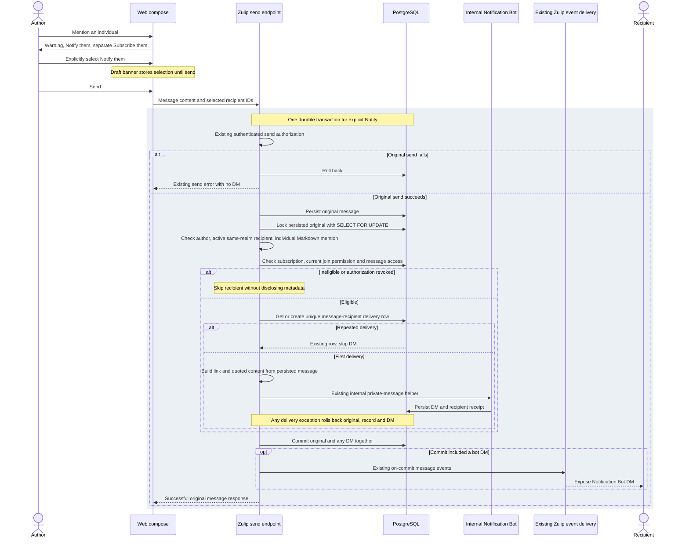

# Explicit notifications for unsubscribed mentions

CoreX AV2 implementation for [Zulip #7719](https://github.com/zulip/zulip/issues/7719).
See [ADR 001](adr-001-mention-notification.md) and [execution evidence](../evidence/av2.md).
The reported `docs/architecture/context.md` C4 Level 1 diagram was absent in
this checkout. No existing context diagram was replaced.

No new queue, worker, bot account, or external service is introduced. Existing
message events and external-notification jobs retain Zulip's on-commit behavior.
The database uniqueness constraint and original-message row lock apply across
processes; this is not a browser-only deduplication flag.

Mermaid syntax and SVG rendering were verified with Mermaid CLI 12.2.0 inside
the Linux test container on 2026-11-09. The editable sequence above is the source.
