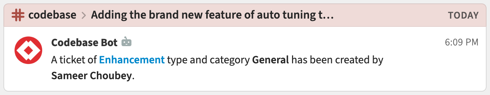

# Zulip Codebase integration

Get Zulip notifications for your Codebase events!

{start_tabs}

1. {!create-an-incoming-webhook.md!}

1. {!generate-webhook-url-basic.md!}

1. Go to your Codebase Dashboard, and click on the settings icon in the
   top-right corner. Click on **Event Hooks**, and click
   **New Event Webhook**.

1. Set **Payload URL** to the URL generated above, and click **Create**.

{end_tabs}

{!congrats.md!}

{!event-filtering-additional-feature.md!}
