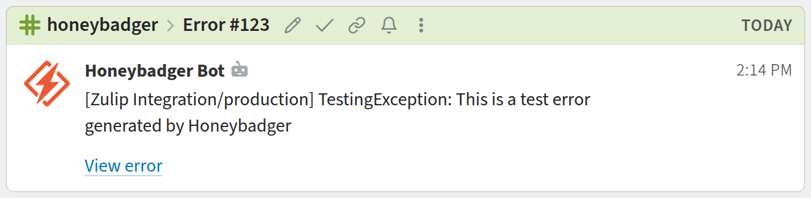

# Zulip Honeybadger integration

Get Honeybadger error, deployment, uptime, check-in, and alarm notifications in Zulip!

{start_tabs}

1. {!create-an-incoming-webhook.md!}

1. {!generate-webhook-url-basic.md!}

1. In your Honeybadger project, go to **Project Settings** > **Alerts & Integrations**.
   Select **Webhook**.

1. Enter the URL you generated, set **Payload version** to **v2**,
   and select the events you want to receive. Save the integration.

{end_tabs}

{!congrats.md!}

Notifications about the same error, uptime monitor, check-in, or alarm share a
topic based on its ID. Deployment and error-volume notifications share a topic
for their project. You can set a fixed topic when generating the webhook URL.

### Related documentation

{!webhooks-url-specification.md!}

{!event-filtering-additional-feature.md!}
